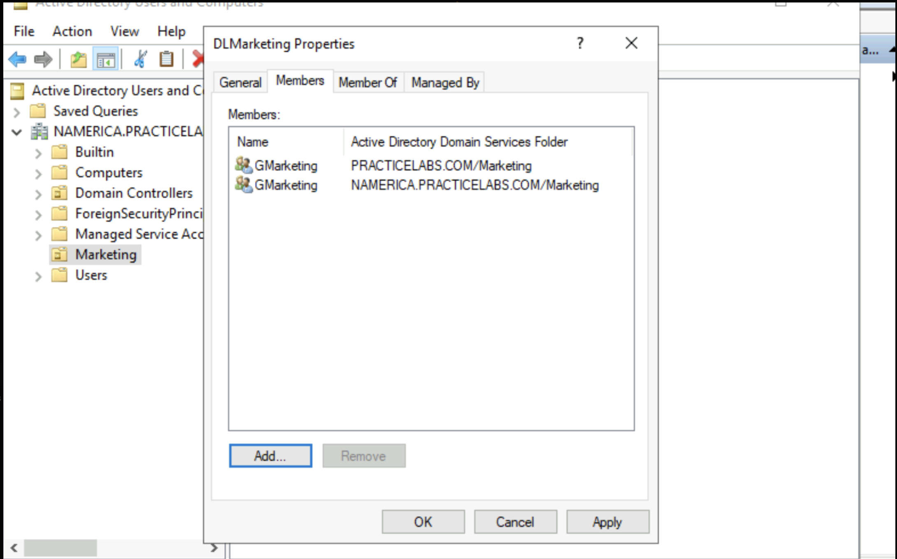
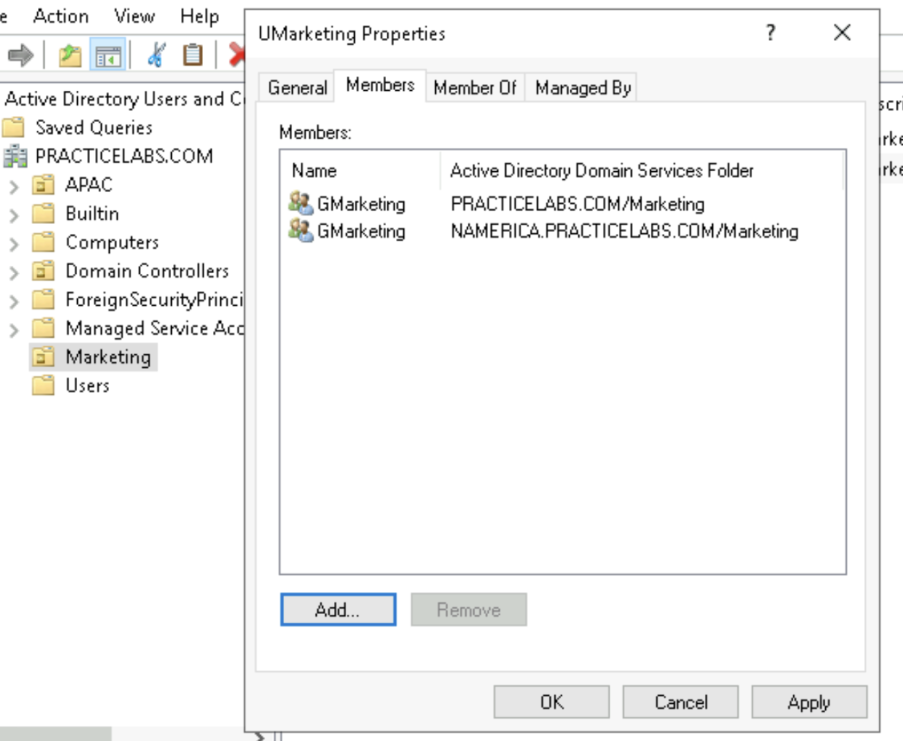
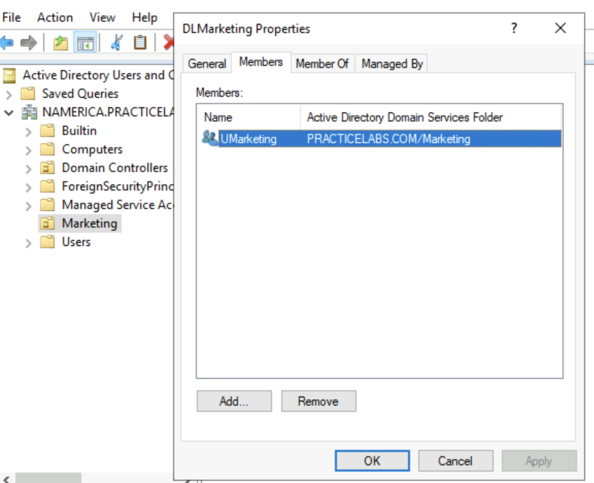
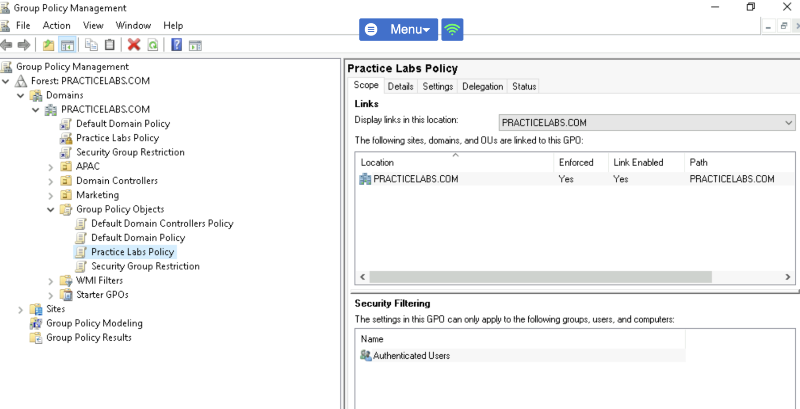
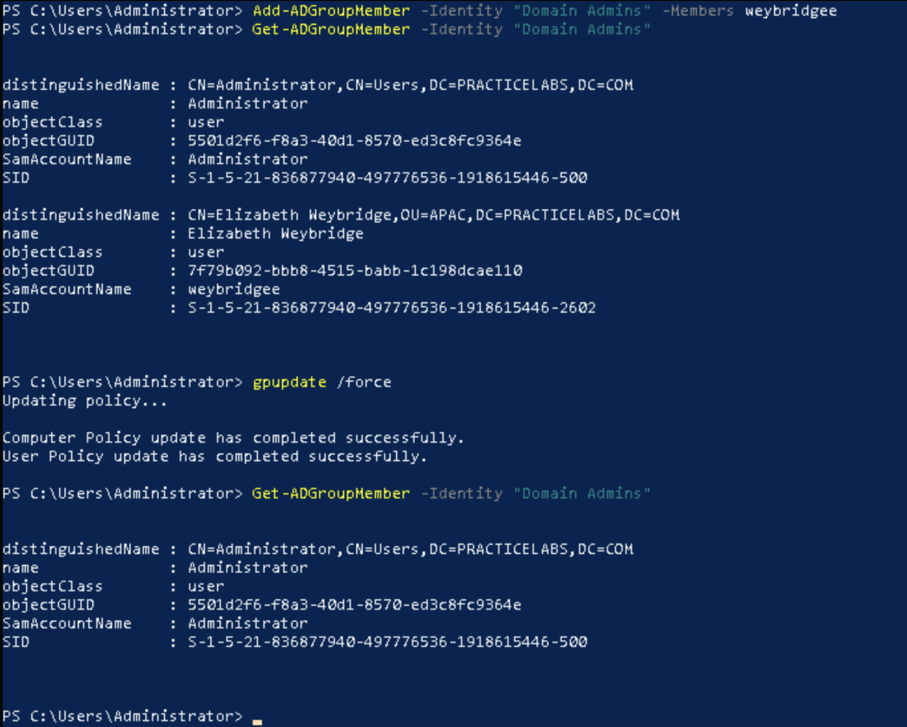

# Active Directory Group and Policy Management Lab

## Overview

This project demonstrates hands-on experience managing Organizational Units (OUs), security groups, shared folders, and Group Policy in Active Directory.

---

## Key Tasks Performed

### Organizational Unit Creation

### Group Creation

### Group Members

### User Membership Verification

### Shared Folder Creation

### Network Drive Mapping

### Folder Permissions

### Group Policy Configuration

### PowerShell Verification

---

## Technical Skills Demonstrated

* Active Directory Administration
* Group Policy Management
* Access Control
* Network Drive Mapping
* PowerShell

---

## Summary

This lab demonstrates practical experience configuring Active Directory groups, permissions, and policies in a simulated enterprise environment.
