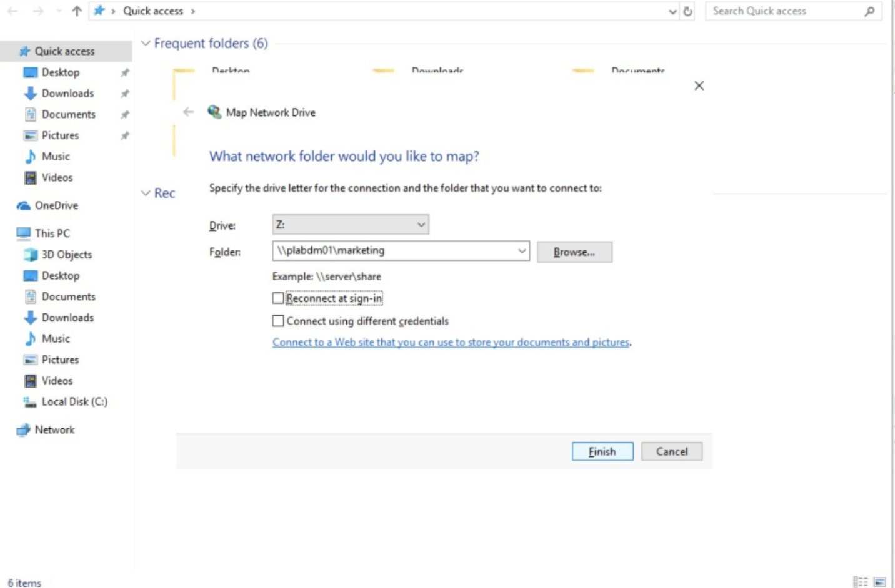

# Active Directory Group and Policy Management Lab

## Overview

This project demonstrates hands-on experience managing Organizational Units (OUs), security groups, shared folders, and Group Policy using administrative tools in a simulated enterprise environment.

---

## Objectives

* Create and manage Organizational Units
* Configure security groups and memberships
* Assign NTFS permissions to shared folders
* Map network drives
* Configure and apply Group Policy Objects (GPOs)
* Verify configurations using PowerShell

---

## Technologies Used

* Windows Server
* Active Directory
* Group Policy Management
* PowerShell

---

## Key Tasks Performed

### Organizational Unit Creation

* Created a dedicated OU for department organization

### Group Management

* Created security groups and added users
* Verified group membership assignments

### File Sharing and Permissions

* Configured shared folder access
* Assigned NTFS permissions to security groups

### Network Drive Mapping

* Connected shared folder to client system

### Group Policy Configuration

* Created and linked a GPO
* Configured restricted group policies

### Verification

* Verified group membership and policy application using PowerShell

---

## Screenshots

### Organizational Unit Creation

### Group Creation

### Group Members

### User Membership Verification

### Shared Folder Creation

### Network Drive Mapping

### Folder Permissions

### Group Policy Configuration

### PowerShell Verification

---

## Technical Skills Demonstrated

* Active Directory Administration
* Group Policy Management
* Access Control and Permissions
* Network Drive Mapping
* PowerShell

---

## Summary

This lab demonstrates practical experience managing Active Directory groups, permissions, and policies in a Windows domain environment.
