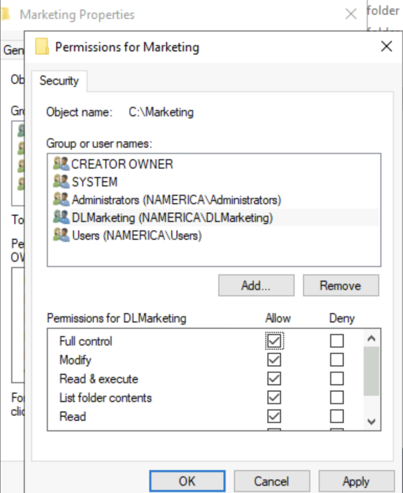
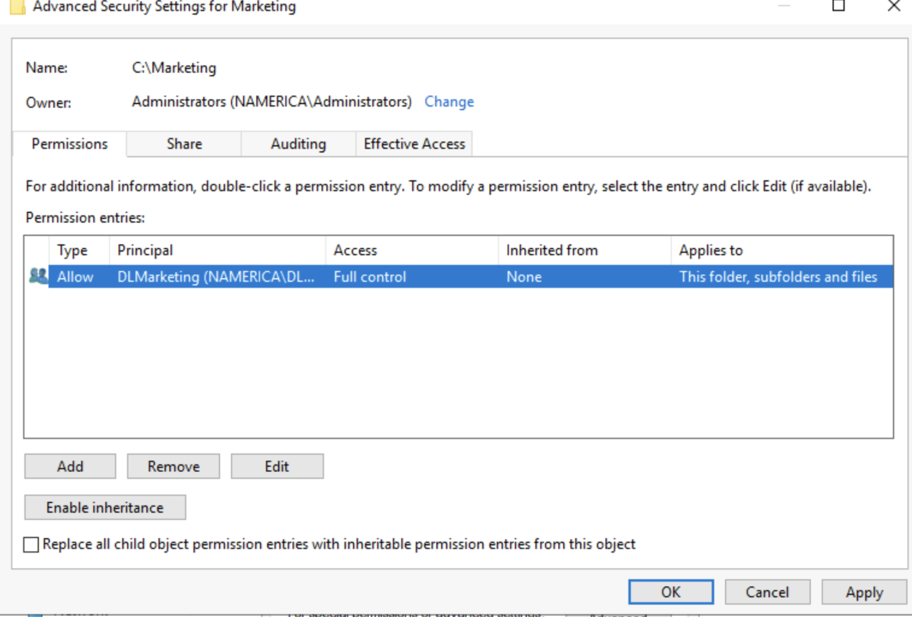
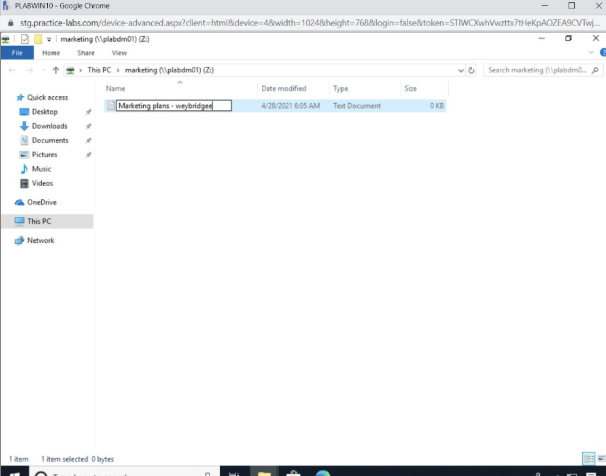

# Active Directory Groups, Permissions, and Group Policy

I wanted to see how a department gets access to a shared drive in a Windows domain. I created an organizational unit and security groups, set permissions on a shared folder, mapped the drive from a client, and checked the Group Policy configuration.

## What I set up

- I organized department accounts in an OU and verified security group memberships.
- I assigned NTFS permissions to security groups and mapped the shared drive from the client.
- I linked a GPO, configured Restricted Groups, and used PowerShell during verification.

## 1. Organizing users and groups

I created the OU first, then set up the security groups and checked which users were members.

## 2. Setting up file access

I created the shared folder, reviewed its permissions, and mapped the drive from a client. I used security groups to manage access so the folder permissions could stay tied to groups as people joined or left.

## 3. Applying Group Policy and checking the results

I created and linked a GPO and configured Restricted Groups. I then used PowerShell to check the configuration and membership.

## What I learned

This made it easier for me to see where I'd start if someone said they couldn't open a shared drive. I'd check their group membership, the folder permissions, and the policy before changing anything.

**Tools:** Windows Server · Active Directory · Group Policy Management · PowerShell · NTFS
